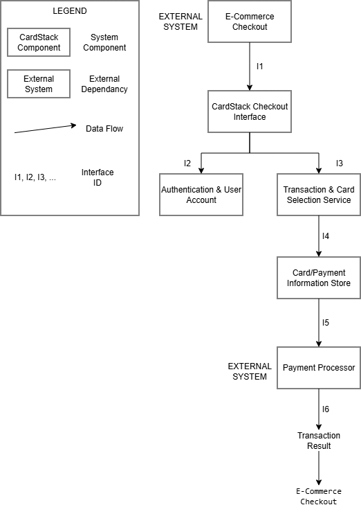

# CardMaxx: Final Design Report

CS 5001 Senior Design, Fall 2026. The project was named **CardStack** until November 2026. All documents now use CardMaxx; only the D0 to D2 diagram files and the earlier draft slides, which are PDF, image, Word, and PowerPoint files, still show the old name.

## Table of Contents

1. [Team Names and Project Abstract](#1-team-names-and-project-abstract)
2. [Project Description](#2-project-description)
3. [User Stories and Design Diagrams](#3-user-stories-and-design-diagrams)
4. [Project Tasks and Timeline](#4-project-tasks-and-timeline)
5. [ABET Concerns Essay](#5-abet-concerns-essay)
6. [PPT Slideshow](#6-ppt-slideshow)
7. [Self-Assessment Essays](#7-self-assessment-essays)
8. [Professional Biographies](#8-professional-biographies)
9. [Budget](#9-budget)
10. [Appendix](#10-appendix)

---

## 1. Team Names and Project Abstract

| Role | Name |
| --- | --- |
| Team member | Luke Brogee |
| Team member | Maya Tomarchio |
| Faculty advisor | Dr. Aurisano |

**Abstract.** CardMaxx is a payment app that links a user's credit cards through Plaid and, at checkout, picks the card that earns the most rewards for the purchase category. It also tracks spending and budgets across linked accounts. Built with Expo (web, iOS, Android), Supabase and Plaid, it never stores card numbers and encrypts bank tokens at rest.

---

## 2. Project Description

People with several credit cards leave rewards unclaimed because they don't know which card earns the most for a given purchase, or don't want to look it up at checkout. CardMaxx is one payment option that does it for them: the consumer links their cards once, and at each checkout CardMaxx charges the linked card with the highest effective value (amount × reward rate × point value) for that purchase's category.

- **Stage one (this project):** a payment wallet that merchants add to their checkout, plus web and mobile apps for linking cards, seeing spending, and managing budgets.
- **Stage two (future):** a single CardMaxx card or credentials usable at any card-accepting merchant, online and in person.

Full description: [Project-Description.md](Project-Description.md).

---

## 3. User Stories and Design Diagrams

### 3.1 User stories

| ID | Story |
| --- | --- |
| US-01 | As an e-commerce developer, I want a checkout option that is easy, fast, and mainstream, faster than typing card details. |
| US-02 | As a consumer, I want each purchase to go to whichever of my cards earns the most for that category. |
| US-03 | As a consumer, I want to pay online with one click instead of entering a card number. |

Use case **UC-01** (purchase on an e-commerce site) and its acceptance criteria UC-01.1 (success within 5 s) and UC-01.2 (declined card, ask before using another), plus the stakeholder map (consumer, merchant, compliance auditor): [User_Stories.md](User_Stories.md).

### 3.2 Design diagrams

| Level | Contents | File |
| --- | --- | --- |
| D0 | High-level block diagram, architecture choice (client-server, layered), success flow | [D0_High_Level_Design.pdf](Design_Diagrams/D0_High_Level_Design.pdf), [D0BlockDiagram.png](Design_Diagrams/D0BlockDiagram.png), [SuccessFlow.png](Design_Diagrams/SuccessFlow.png) |
| D1 | Detailed design: data model, API contracts, build vs reuse | [D1_Detailed_Design.pdf](Design_Diagrams/D1_Detailed_Design.pdf) |
| D2 | Detailed design: components, transaction state machine, edge cases, interface revisions | [D2_Detailed_Design.pdf](Design_Diagrams/D2_Detailed_Design.pdf) |
| D3 | Task list, milestones, effort matrix, risk register | [D3__Assignment8.docx](Design_Diagrams/D3__Assignment8.docx) |
| Peer review | Review notes that drove D2 changes | [Peer_Review_Notes.md](Design_Diagrams/Peer_Review_Notes.md) |

D0 to D2 describe the **target design** (drawn under the old CardStack name). What has been built so far, and how it differs (backend, sign-in, checkout), is recorded in the Technical Specification v1.1, ["As built this semester"](Technical_Specification.md#1-version-and-change-log).

### 3.3 Components

| Component | Purpose |
| --- | --- |
| Checkout Button | Embedded on a merchant's checkout page; loads only for a registered button ID on its allowed domain. |
| Checkout Interface | Sign-in popup and confirmation page showing amount, merchant, and selected card before charging. |
| Authentication & User Account | Signs consumers in and manages sessions (30-minute inactivity limit). |
| Transaction & Card Selection Service | Ranks the consumer's cards by effective value for the purchase category and applies tie-breaks. |
| Card Processing | Charges the chosen card by processor token with an idempotency key; asks before falling back to the next card. |
| Financial Institution Setup | Links cards and bank accounts through Plaid Link; stores only encrypted tokens. |
| Transaction Lifecycle and reconciliation | Moves each transaction through its states and resolves timeouts. |
| Merchant webhooks | Sends merchants a signed result, retrying with backoff. |
| Receipt forwarding | Emails the consumer a receipt after a successful purchase. |
| Card/Payment Information Store | Supabase PostgreSQL; tokens and last four digits only, never full card numbers. |
| Web and mobile apps | One Expo codebase: Home (net worth, spending, budgets), Wallet, Activity, Help, Settings. |

### 3.4 Conventions

- **IDs:** requirements `REQ-xx`, non-functional `NFR-xx`, constraints `CON-xx`, test cases `TC-xx.y`, user stories `US-xx`, use cases `UC-xx`, tasks `T-xx`, milestones `Mx`. IDs are never reused; a dropped requirement is marked withdrawn.
- **Money:** integer cents everywhere; never floating point.
- **APIs:** JSON over HTTPS; errors return a status code plus an error code.
- **Security:** no full card numbers (PANs) are stored, logged, or passed through; secrets live in environment variables, never in the repository.
- **Code layout (`client/`):** screens in `src/app`, shared components in `src/ui`, data and business logic in `src/data`, server-only code in `src/server`, database scripts in `supabase/`.

### 3.5 Requirements, specification, and test plan

- [Requirements_Document.md](Requirements_Document.md): every requirement with its MoSCoW priority, source story, and verification method.
- [Technical_Specification.md](Technical_Specification.md): architecture, interfaces and data formats, technology stack, and the as-built record.
- [Test_Plan.md](Test_Plan.md): scope, success criteria, test cases TC-01 to TC-27, environment, and schedule.

### 3.6 Traceability matrix

Every requirement maps to a design element and at least one test case in the Test Plan, and every test case maps back to a requirement. **Status:** *Designed* = in D0 to D2 only; *Prototype* = working on the [`feature/cardstack-prototype`](https://github.com/Maya2234/capstone/tree/feature/cardstack-prototype) branch; *Built* = in the main CardMaxx app; *Partly built* = some of it is in either; *Planned* = scheduled for next semester.

| Req ID | Requirement | Design element | Test case | Status |
| --- | --- | --- | --- | --- |
| REQ-01 | Button loads only for registered ID and allowed domain | Checkout Button; checkout_button table; GET /button/{id} (D1, D2) | TC-01 | Prototype |
| REQ-02 | Google sign-in; re-prompt on invalid or expired token | Authentication & User Account (D0); auth state machine, I2 (D2) | TC-02 | Partly built (email sign-in built; Google planned) |
| REQ-03 | Confirm amount, merchant, and selected card before charging | Checkout Interface (D0); login popup and checkout pages (D2) | TC-03 | Built (demo checkout) |
| REQ-04 | Pick the highest effective-value card, with tie-breaks | Transaction & Card Selection Service (D0); Automatic Card Selection, EC-01, EC-02 (D2) | TC-04 | Built (tie-break order partly) |
| REQ-05 | Charge by processor token with idempotency key | Card Processing (D1); I5, EC-03 (D2) | TC-05 | Prototype (mock processor) |
| REQ-06 | Link cards via Plaid; verify webhook signature | Financial Institution Setup, /connect-bank-account (D1); I9, EC-05 (D2) | TC-06 | Partly built (linking built; webhooks planned) |
| REQ-07 | Return payment result to merchant and route back | Checkout Interface, I6 (D0); D-05 (D0) | TC-07 | Prototype |
| REQ-08 | Ask consent before charging the next-ranked card | Card Processing ranked fallback (D2); peer review PR-2 | TC-08 | Prototype |
| REQ-09 | Signed merchant webhook with 5 retries | Merchant webhook, webhook_delivery, EC-06 (D2) | TC-09 | Prototype |
| REQ-10 | UNKNOWN after 10 s timeout; reconcile within 15 min | Transaction Lifecycle (D2, Figure 2); EC-04 (D2) | TC-10 | Prototype |
| REQ-11 | Paginated transaction history in both apps | Transaction history, I10 (D2); Mobile app, Web app (D2) | TC-11 | Partly built (history shown, not paginated) |
| REQ-12 | List, remove, and set a preferred card | Card management I8 (D2); user_card.preferred (D2) | TC-12 | Partly built (list and on/off built; preferred planned) |
| REQ-13 | Receipt email within 1 minute of SUCCEEDED | Receipt forwarding, I11 (D2) | TC-13 | Partly built (queued in prototype; no email yet) |
| REQ-14 | Empty state with Add a card | Mobile app and Web app, EC-09 (D2) | TC-14 | Built |
| REQ-15 | Record selection reason in the selection log | selection_log table (D2) | TC-15 | Prototype |
| NFR-01 | 95% of checkouts back to merchant within 5 s at 20 concurrent | Performance and Timing (D0); single ranked-list call (D2) | TC-16 | Designed |
| NFR-02 | Button lookup under 300 ms at p95 | Indexed button_id and allowed_domain (D1) | TC-17 | Designed |
| NFR-03 | No PANs stored, logged, or passed through | Token-only storage (D2); Logging glue component (D2); D-02 (D0) | TC-18 | Built |
| NFR-04 | TLS 1.2+ in transit, AES-256 at rest | Configuration glue component (D2); Card/Payment Information Store (D0) | TC-19 | Built |
| NFR-05 | 30-minute session expiry; signed webhooks | Authentication session (D2); I6 HMAC header, I9 (D2) | TC-20 | Partly built (expiry built; webhooks in prototype) |
| NFR-06 | Checkout in 3 clicks, under 30 s, 90% success | Login popup and checkout pages (D2); UC-01 flow | TC-21 | Planned |
| NFR-07 | First card linked in under 3 min, 80% success | Mobile app add-card screen with Plaid Link (D2) | TC-22 | Planned |
| NFR-08 | API availability of 99% monthly from M9 | Client-server deployment, Scalability (D0); hosting (D2 rationale 10) | TC-23 | Planned |
| NFR-09 | No transaction stuck over 15 min in PROCESSING or UNKNOWN | Transaction Lifecycle and reconciliation job (D2) | TC-24 | Prototype |
| CON-01 | Costs covered by personal funds | Build vs Reuse (D1); free-tier stack choices (spec Section 4) | TC-25 | Built (see Section 9) |
| CON-02 | Faculty expertise in final stages | Advisor and faculty reviews (D3 milestones M6, M12) | TC-26 | Planned |
| CON-03 | Security planned, documented, tested, overseen | Configuration and Logging glue components (D2); D-02 (D0) | TC-18, TC-19, TC-20 | Partly built |
| CON-04 | No consumer fees | Pricing excluded from all consumer flows (D2 overview) | TC-27 | Built |
| CON-05 | No plain-text PANs | Token-only Card/Payment Information Store (D2); D-02 (D0) | TC-18 | Built |

Reverse check: TC-01 to TC-27 each appear above; no test case lacks a requirement.

---

## 4. Project Tasks and Timeline

Seventeen tasks (T-01 to T-17), each tied to a module and an owner (Luke 9, Maya 8), are listed in [Tasklist.md](Tasklist.md). Planned hours per person are in the effort matrix, [planning/D3_Effort_Matrix.xlsx](planning/D3_Effort_Matrix.xlsx) (split about 52% Luke, 48% Maya).

| Milestone | What it shows | Tasks | Date |
| --- | --- | --- | --- |
| M1 | High-level design (D0) and scope approval | — | 10/02/2026, done |
| M2 | Detailed design (D1, D2) with peer review | — | 10/08 and 10/14/2026, done |
| M3 | D3 planning package | — | 10/30/2026, done |
| M4 | Data and sign-in foundation | T-01, T-02, T-03, T-05 | 11/20/2026, done |
| M5 | Week 14 progress report | — | 11/23 to 11/29/2026 |
| M6 | Fall foundation complete | T-04, T-07 | 12/04/2026 |
| M7 | Card store and selection API | T-06, T-08 | 01/22/2027 |
| M8 | Bank linking and mobile alpha | T-11, T-15 | 02/05/2027 |
| M9 | First sandbox payment | T-09, T-16 | 02/19/2027 |
| M10 | Transaction lifecycle and history | T-10, T-13 | 03/05/2027 |
| M11 | Notifications complete | T-12, T-14 | 03/26/2027 |
| M12 | End-to-end system validated | T-17 | 04/09/2027 |
| M13 | Final presentation and demo | — | 04/20/2027 |

Beyond the plan, this semester also delivered the design presentation (11/17), the working prototype, and the CardMaxx app with real Plaid linking, Supabase storage, spending and budgets, and a demo checkout. Each milestone has a protected buffer week before it (B-M4 to B-M13).

---

## 5. ABET Concerns Essay

The constraints essay covers seven areas:

- **Economic:** third-party API costs paid from personal funds, with possible UC innovation challenge funding.
- **Professional:** faculty expertise sought in the final stages.
- **Security:** planned, tested, and overseen because card and bank data are sensitive; encrypted tokens, two-factor login, 30-minute sessions.
- **Social:** no fees for consumers.
- **Ethical:** card choice always in the user's interest, confirmation before every charge, AI use disclosed.
- **Legal:** no full card numbers (PCI DSS scope), provider terms, Gramm-Leach-Bliley consent, licenses and trademarks.
- **Diversity and cultural:** works for everyday cards, no decisions based on personal traits, accessible interface, US-only limitation recorded.

These became constraints CON-01 to CON-05 in the requirements. Full essay: [Constraints_Essay.md](Constraints_Essay.md). Related: [ethics_statement.md](ethics_statement.md) (privacy, security, licensing, AI use).

---

## 6. PPT Slideshow

- Final design presentation: [CardMaxx_Design_Presentation.pptx](Presentation/CardMaxx_Design_Presentation.pptx) ([PDF](Presentation/CardMaxx_Design_Presentation.pptx.pdf))
- Earlier draft, reviewed by the advisor: [CardStack_Design_Presentation_Draft.pdf](Presentation/CardStack_Design_Presentation_Draft.pdf)
- Advisor feedback on the draft (11/17/2026): [Advisor_Feedback.md](Presentation/Advisor_Feedback.md); presentation run sheet: [Run_Sheet.md](Presentation/Run_Sheet.md)

---

## 7. Self-Assessment Essays

Each member wrote an individual team and self assessment: ratings of each teammate on contribution, communication, reliability, and quality of work, a reflection on how the team divided work and made decisions, and a reflection on their own growth and design decisions this semester. Because these contain peer ratings, they are not stored in this repository; each member submitted theirs as a PDF through Canvas.

| Member | Submitted |
| --- | --- |
| Luke Brogee | Canvas (PDF) |
| Maya Tomarchio | Canvas (PDF) |

---

## 8. Professional Biographies

- **Luke Brogee** — Computer Science; contact and work experience in the biographies.
- **Maya Tomarchio** — Software development intern at Siemens (NX CAD), previously Wolters Kluwer and a research co-op at Feng Chia University; Python, C++, C#, JavaScript, React, SQL.

Full biographies and contact details: [Professional-Biographies.md](Professional-Biographies.md).

---

## 9. Budget

**Expenses to date: none ($0).** Every service used so far is on a free plan, and nothing else has been purchased:

| Item | Plan | Cost |
| --- | --- | --- |
| Supabase (database and sign-in) | Free | $0 |
| Plaid (card and bank linking) | Trial / Sandbox | $0 |
| Resend (support email) | Free | $0 |
| Expo (app framework) | Free, open source | $0 |
| GitHub (repository) | Free | $0 |

---

## 10. Appendix

### 10.1 References

- Plaid documentation: https://plaid.com/docs/
- Supabase documentation: https://supabase.com/docs
- Expo and Expo Router documentation: https://docs.expo.dev/
- Stripe documentation and test cards: https://docs.stripe.com/testing
- Card reward data: compiled from each issuer's public product page; every entry records its source URL and an as-of date (`client/src/data/card_products.json`).

### 10.2 Repository links

- Main branch (CardMaxx app and all documents): https://github.com/Maya2234/capstone
- Prototype branch (Go API, prototype consumer app, demo merchant store): https://github.com/Maya2234/capstone/tree/feature/cardstack-prototype
- App setup and run instructions: [client/README.md](client/README.md)

### 10.3 Meeting notes

- Advisor review of the design presentation, 11/17/2026: [Presentation/Advisor_Feedback.md](Presentation/Advisor_Feedback.md)
- Advisor review of the technical specification: [Technical_Specification.md, Section 7](Technical_Specification.md#7-advisor-review)
- Peer review of D1 and D2: [Design_Diagrams/Peer_Review_Notes.md](Design_Diagrams/Peer_Review_Notes.md)
- Team roles, meeting schedule, and decision process: [Team_Contract.md](Team_Contract.md)

### 10.4 Evidence of effort (45 hours per member)

| Member | Total hours | Design notebook |
| --- | --- | --- |
| Luke Brogee | 46 | [notebooks/brogee_notebook.md](notebooks/brogee_notebook.md) |
| Maya Tomarchio | 47 | [notebooks/tomarchio_notebook.md](notebooks/tomarchio_notebook.md) |

Supporting evidence: the planned hours in the [effort matrix](planning/D3_Effort_Matrix.xlsx), and the commit history (both members, September to November 2026): https://github.com/Maya2234/capstone/commits/main

### 10.5 Repository contents

| Path | What it is |
| --- | --- |
| [client/](client) | CardMaxx app: one Expo codebase for the website, iPhone, and Android |
| [Design_Diagrams/](Design_Diagrams) | D0 to D3 design documents, diagrams, and peer review notes |
| [Presentation/](Presentation) | Design presentation, draft, advisor feedback, run sheet |
| [planning/](planning) | Effort matrix and assignment checklists |
| [branding/](branding) | CardMaxx logo, wordmark, app icons |
| [Team_Contract.md](Team_Contract.md) | Team roles, meeting schedule, and decision process |
| [ethics_statement.md](ethics_statement.md) | Privacy, security, licensing, attribution list, and AI-use disclosure |
| [notebooks/](notebooks) | Each member's weekly design notebook |

Attribution for libraries, adapted code, datasets, and assets: [ethics_statement.md, Section 5](ethics_statement.md#5-attribution-list).
